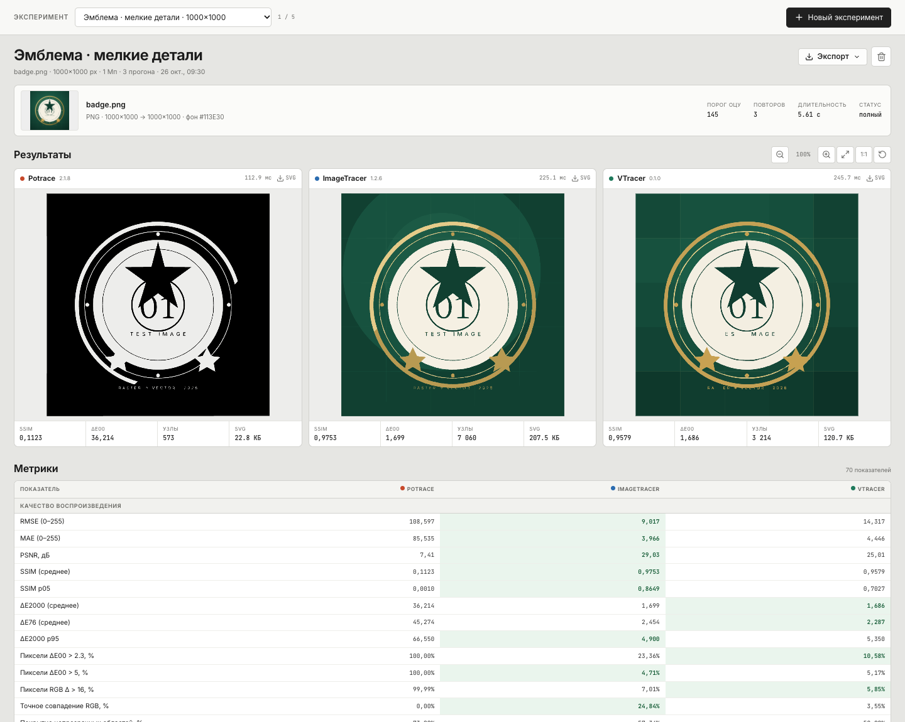
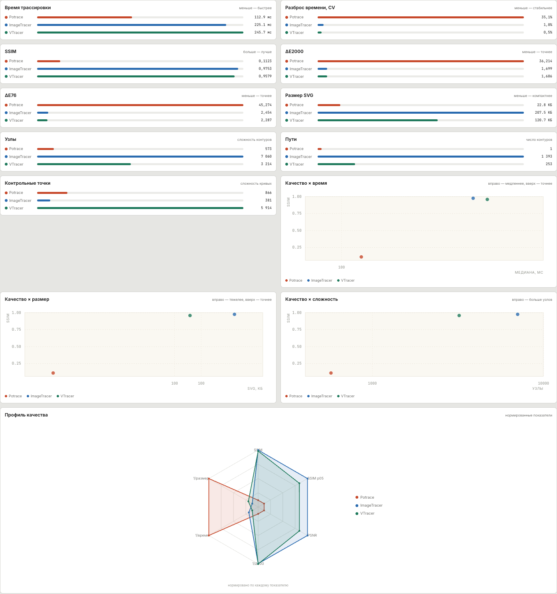
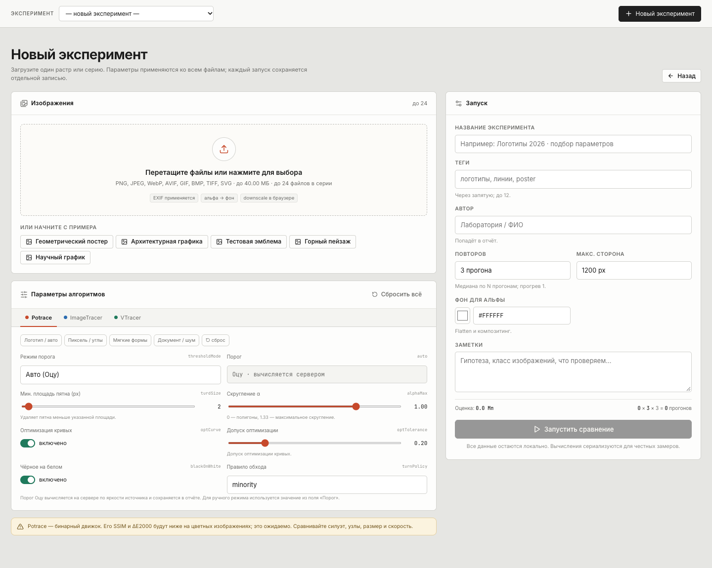

# Сравнение методов векторизации

Локальное приложение для одной задачи: загрузить растровое изображение, прогнать его через три векторизатора и посмотреть результаты рядом.

| Метод | Версия | Подход | Лицензия |
|---|---|---|---|
| **Potrace** | 2.1.8 (node-potrace) | бинарная трассировка, кривые Безье | GPL-2.0 |
| **ImageTracer** | 1.2.6 | цветовая квантизация | Unlicense |
| **VTracer** | 0.1.0 (WASM) | иерархическая цветовая кластеризация | MIT |

Все три метода получают один и тот же нормализованный RGBA-массив. Результаты, SVG, рендеры, параметры и замеры времени сохраняются на диск.





## Быстрый старт

```bash
cd vecbench
./build.sh     # один раз или после изменений интерфейса
./start.sh     # http://127.0.0.1:8810
```

`start.sh` сам ищет Node.js, в том числе встроенный runtime DSH. Другой порт:

```bash
PORT=9000 ./start.sh
```

Требования: Node.js 20.19+ / 22.12+ (проверено на 24), macOS/Linux. Всё считается локально.

## Как устроен интерфейс

**Одна страница эксперимента, без дашбордов и боковых панелей.**

- Вверху — выбор эксперимента из сохранённых и кнопка нового запуска. Никакого логотипа и названия продукта.
- Серая страница, белые карточки, три метода строго в ряд: Potrace · ImageTracer · VTracer.
- Под изображениями — компактные SSIM / ΔE2000 / узлы / размер.
- Ниже — большая таблица метрик (около 70 показателей).
- Ещё ниже — 13 графиков: время, CV времени, SSIM, ΔE2000, ΔE76, размер SVG, узлы, пути, контрольные точки, три диаграммы «качество × …» и профиль качества.
- Общий zoom/pan для всех трёх изображений, кнопки «Вписать» и «1:1».
- Экспорт — HTML-отчёт, печать/PDF, CSV, JSON, Markdown, LaTeX, ZIP.

Страница нового эксперимента — загрузка файла, имя/теги/заметки, повторы, разрешение, фон и параметры трёх движков. Можно загрузить один файл или серию.



## Метрики

В таблицу попадают:

- **Качество**: RMSE, MAE, PSNR, SSIM, SSIM p05, ΔE2000, ΔE76, ΔE2000 p95, доля пикселей выше JND, доля ΔE00 > 5, доля RGB-отличий, точное совпадение RGB, покрытие, отклонение покрытия, отклонение числа цветов.
- **Силуэт**: IoU, Dice/F1, precision, recall, accuracy, 1 − IoU (для Potrace и бинарного VTracer).
- **Структура SVG**: пути, подконтуры, узлы, сегменты, линии, кривые, контрольные точки, цвета, точность координат, длина контуров, средний сегмент, узлы на путь, сегменты на путь, контрольные точки на узел, доля кривых, шаг узлов, длина контуров на 1000 px², bbox/кадр, узлы на Мп, градиенты.
- **Производительность**: медиана, среднее, min/max, стандартное отклонение, CV, все прогоны, время на 1 Мп, Мп/с, узлов/мс, время на узел.
- **Файлы**: SVG, gzip, gzip %, байт на пиксель, байт на узел, байт на путь, путей на 1000 px², детерминированность, SHA-1.
- **Производные**: SSIM на 1 КБ, SSIM на 1 мс, IoU на 1 КБ, PSNR на 1 КБ, пикселей на узел, покрытие на 1 КБ.

Лучшие значения подсвечиваются зелёным. Для Potrace цветовые метрики справочные — он бинарный; корректнее смотреть силуэт, узлы, размер и скорость.

## Методика

- **Время**: только вызов движка после прогрева; N измеренных прогонов, ротация порядка, глобальная очередь. Медиана и все прогоны сохраняются.
- **SSIM**: яркость, Gaussian 11×11, σ=1.5; среднее и 5-й процентиль.
- **ΔE2000 / ΔE76**: попиксельно в CIELAB после композитинга прозрачных областей на фон метрик.
- **RMSE / MAE / PSNR**: RGB после композитинга.
- **Силуэт**: маска Оцу; показывается только там, где сравнение имеет смысл.
- **Фон метрик**: для непрозрачных изображений оценивается по рамке, для альфа-изображений — выбранный фон нормализации.

Подробно: [docs/METHODOLOGY.md](docs/METHODOLOGY.md).

## Сохранение и экспорт

```
data/
├── index.json
└── experiments/<id>/
    ├── record.json
    ├── source.png / original.*
    ├── thumb.png
    ├── svg-<engine>.svg
    ├── render-<engine>.png
    ├── heatmap-<engine>.png
    ├── heatmap-fixed-<engine>.png
    ├── ssim-<engine>.png
    └── diff-<engine>.png
```

Экспорт одного эксперимента:

- `HTML` — автономный отчёт с таблицами, SVG, ROI и картами различий;
- `PDF` — через печать отчёта;
- `CSV` — строка на движок;
- `JSON` — полная запись + SVG;
- `Markdown` — текстовая версия;
- `LaTeX` — таблица booktabs;
- `ZIP` — отчёт, данные, SVG и PNG.

Формат записи: [docs/DATA_FORMAT.md](docs/DATA_FORMAT.md).

## API

| Метод | Путь | Назначение |
|---|---|---|
| GET | `/api/health` | состояние и лимиты |
| GET | `/api/config` | движки, пресеты, параметры |
| GET | `/api/samples` | примеры |
| GET | `/api/experiments` | список |
| POST | `/api/experiments` | multipart: `normalized`, `original`, `meta`; `?sync=1` — JSON, иначе NDJSON-прогресс |
| GET/PATCH/DELETE | `/api/experiments/:id` | запись, метаданные, удаление |
| GET | `/api/experiments/:id/file/:kind/:engine?` | `source`, `thumb`, `original`, `svg`, `render`, `heatmap`, `heatmapFixed`, `ssim`, `diff` |
| GET | `/api/experiments/:id/roi` | метрики ROI |
| POST/DELETE | `/api/experiments/:id/rois[/:roiId]` | сохранение ROI |
| GET | `/api/experiments/:id/export?format=html\|md\|csv\|json\|latex\|zip` | отчёт |
| GET | `/api/export?format=csv\|json\|md\|zip` | датасет |

## Тесты

```bash
node --test tests/*.test.js   # unit + API integration
node tests/e2e.mjs            # браузерный сценарий
```

Проверяется: Otsu, разбор SVG, нормализация, SSIM/ΔE2000/карты, LaTeX, полный API-цикл (создание → SVG → ROI → экспорт → patch → delete), новая одностраничная верстка (3 колонки, таблица метрик, графики, экспорт, страница нового запуска).

## Разработка

```bash
node scripts/dev.mjs          # API :8810 + Vite :5175
node scripts/generate-samples.js
node scripts/seed-demo.mjs    # внимание: удаляет текущие эксперименты
```

Сборка: `./build.sh` или `node scripts/build.mjs`.

## Ограничения

- Potrace бинарный: его SSIM/ΔE2000 на цветных изображениях — не оценка «победы/поражения».
- ImageTracer и VTracer имеют разные модели цвета; параметры по умолчанию — стартовая точка.
- Абсолютные миллисекунды зависят от машины и фоновой нагрузки.
- Метрики считаются на рабочем разрешении (`maxSide`); при сильном уменьшении детали исчезают до трассировки.
- Один эксперимент — не статистика; для выводов нужна серия.

## Лицензии

Код — MIT (см. [LICENSE](LICENSE)). **Potrace/node-potrace — GPL-2.0**, VTracer и `@neplex/vectorizer` — MIT, ImageTracer — Unlicense, resvg — MPL-2.0. Полный список: [THIRD_PARTY_NOTICES.md](THIRD_PARTY_NOTICES.md).

## Troubleshooting

- **Порт занят** — `PORT=8811 ./start.sh`.
- **Node не найден** — `NODE_BIN=/path/to/node ./start.sh`.
- **Сборка падает на `dlopen` Rollup** — используйте `./build.sh`; он готовит подписанную копию Node в `.tools/`.
- **Очень большой SVG ImageTracer** — уменьшите `numberofcolors` или увеличьте `pathomit`.
